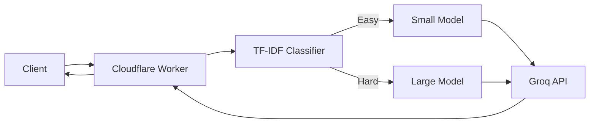

# Intelligent Multi-Tier LLM Model Router

**Live demo:** (coming soon)

Routes queries to small or large language models to reduce costs while maintaining quality near the always-large baseline.

## Architecture

## Results
(Results from evaluation will be added here with evidence links)

## Cost
| Item | Price | Source and date | Cost per 1K requests |
|---|---|---|---|
| (To be measured) | | | |

## Decisions (ADRs)
(Links to docs/adr/*.md will be added here)

## Security
(Link to docs/threat-model.md will be added here)

## Limitations and failure modes
- Limited by Groq free tier: 200K tokens/day across all models
- Classifier runs client-side in Worker with 10ms CPU limit
- Quality depends on training data representing production distribution

## Operations
(Link to docs/ops.md will be added here)

## KEAL gates passed
(Link to docs/keal-gates.md will be added here)

## Run it
(Development instructions will be added as project progresses)
