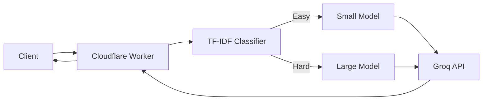

# Intelligent Multi-Tier LLM Model Router

**Live demo:** (coming soon)

Routes queries to small or large language models to reduce costs while maintaining quality near the always-large baseline.

## Architecture


## Results
(Results from evaluation will be added here with evidence links)

## Cost
| Item | Price | Source and date | Cost per 1K requests |
|---|---|---|---|
| (To be measured) | | | |

## Decisions (ADRs)
(Links to docs/adr/*.md will be added here)

## Security
(Link to docs/threat-model.md will be added here)

## Limitations and failure modes
- Limited by Groq free tier: 200K tokens/day across all models
- Classifier runs client-side in Worker with 10ms CPU limit
- Quality depends on training data representing production distribution

## Operations
(Link to docs/ops.md will be added here)

## KEAL gates passed
(Link to docs/keal-gates.md will be added here)

## Development Setup

### Quick Start

**1. Install dependencies:**
```bash
# Bash
bash setup.sh

# PowerShell
.\setup.ps1
```

**2. Set Groq API key:**
```bash
# Get free API key from: https://console.groq.com/keys
export GROQ_API_KEY=your_key_here
```

**3. Generate evaluation dataset:**
```bash
cd datasets
python sample_datasets.py
```

**4. Run pilot evaluation:**
```bash
cd evaluation
python runner.py --model groq-20b --limit 20
```

See [evaluation/README.md](evaluation/README.md) for full evaluation workflow.

### Project Status

**Current Phase:** P4 Validation & Baselines (KEAL Framework)

- [x] Feasibility test (Worker CPU test PASSED: 0.011ms p95)
- [x] Dataset sampling infrastructure
- [x] Evaluation runner with rate limiting and caching
- [ ] Run baseline measurements (400 prompts × 2 models)
- [ ] Build grading infrastructure
- [ ] Train classifier
- [ ] Build Cloudflare Worker
- [ ] Build demo UI
- [ ] Full evaluation and documentation

See [PROJECT_PLAN.md](PROJECT_PLAN.md) for complete timeline.
